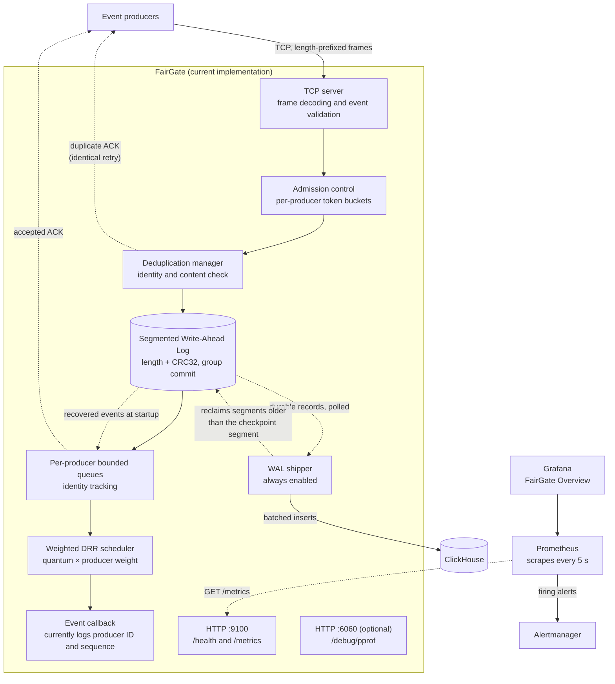
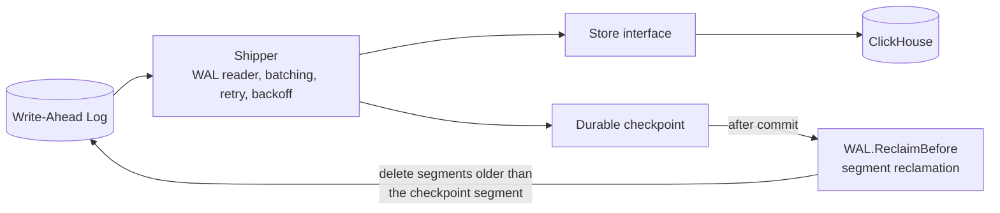
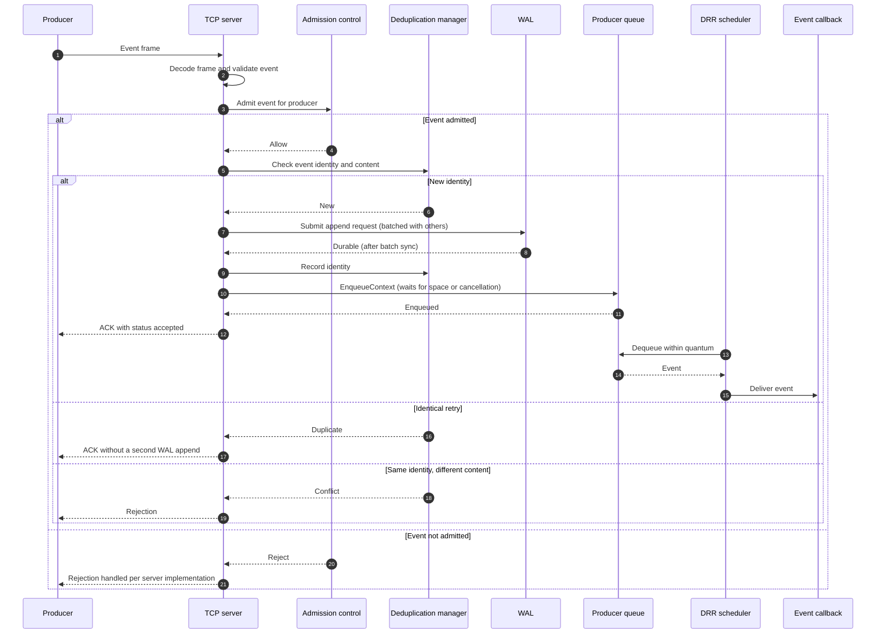

[FairGate](../README.md) › [Docs](README.md) › Architecture

# Architecture

## Overview

FairGate is a modular event-ingestion gateway. It accepts framed event streams over TCP, applies admission control, deduplicates retried events by a stable event identity, persists accepted events in a segmented Write-Ahead Log (WAL) with group commit, schedules events from per-producer queues using weighted Deficit Round Robin (DRR), and ships durable WAL records to ClickHouse through a checkpointed shipper that also reclaims fully shipped WAL segments.

FairGate provides end-to-end exactly-once delivery from producer to ClickHouse, keyed by event identity. Events are persisted in the WAL before acknowledgment, and producers retry until acknowledged. The shipper records each batch as pending before inserting it, so a restart replays exactly the same WAL range. The ClickHouse adapter skips any event whose `event_id` is already stored before it inserts. Each event identity is stored once, regardless of crashes, replays, lost checkpoints, or ClickHouse's insert-deduplication window. Integration tests against a Docker-hosted ClickHouse verify this across a crash before checkpoint commit, a restart with more durable records, and a full re-ship of the WAL. The guarantee assumes a single gateway writes each event identity. See [Delivery semantics](delivery-semantics.md) for the exact scope.

The project explores fair resource sharing in event-ingestion systems: keeping producers isolated from one another through bounded buffering, admission limits, and fair scheduling. FairGate is being developed as an open-source foundation that can be extended with different storage backends and downstream processing components.

## Design goals

| Goal | Approach |
|---|---|
| Producer isolation | Each producer has its own bounded queue, so one producer cannot consume another producer's buffer space. |
| Fair service | Weighted DRR scheduling visits producer queues in rounds and serves each a share proportional to its configured weight. |
| Bounded resource usage | Every queue has an explicit capacity, and a full queue applies backpressure instead of growing. Shipped WAL segments are reclaimed instead of accumulating. |
| Durability before acknowledgment | Events are appended to the WAL and synchronized to disk (via group commit) before an acknowledgment is sent. |
| Safe producer retries | Every event has a stable identity. An identical retry is acknowledged without a second WAL append, and conflicting reuse of an identity is rejected. |
| Extensibility | Core ingestion and scheduling are independent of event meaning. Storage and processing attach through well-defined seams. |

## Architecture

### Current implementation

The diagram below shows the ingestion and WAL shipping paths in the gateway runtime.

Accepted events are checked for duplicates, appended to the WAL, enqueued, and then acknowledged to the client. An identical retry of an event that was already accepted is acknowledged without being appended again. The scheduler callback logs selected events. The server always runs a WAL shipper that writes batches to ClickHouse independently of the scheduler and reclaims WAL segments once they are fully shipped. Alongside the TCP listener, the gateway serves `/health` and Prometheus `/metrics` on port `9100`; in the Compose stack Prometheus scrapes it and Grafana visualizes the result.

The server's goroutine and context structure, including the shutdown path, is described in [Server lifecycle and graceful shutdown](server-lifecycle.md).

### WAL shipping component

The shipper is always enabled and does not depend on `FAIRGATE_SHIPPER_ENABLED`. It reads durable WAL records from its checkpoint, records each batch as pending, inserts it through the `Store` interface, and commits the checkpoint only after insertion succeeds. It then calls `WAL.ReclaimBefore` with the committed position, which deletes segments older than the checkpoint segment. At the WAL end it polls for new durable records.

### Component responsibilities

| Package | Responsibility |
|---|---|
| `internal/server` | TCP listener, per-connection goroutines, connection tracking, frame handling, idempotent event handling (deduplication check, duplicate ACKs), acknowledgment delivery, server lifecycle (`RunContext`), required shipper startup and shutdown, graceful shutdown, and the HTTP health and Prometheus metrics endpoint. |
| `internal/wire` | Frame codec (5 MiB maximum frame size), event and acknowledgment types, validation including `producer_epoch`. |
| `internal/admit` | Token-bucket admission control, with optional per-producer rate and burst. |
| `internal/overload` | Backlog-aware overload control: refuses events before the WAL append when the producer's queue, the gateway's total queue, or the shipper lag is over its limit, with hysteresis on the sampled gateway-wide signals. |
| `internal/sched` | Per-producer bounded queues with optional per-producer capacities (including context-aware `EnqueueContext` and event identity tracking) and the weighted DRR scheduler. |
| `internal/wal` | Segmented WAL, writer goroutine with group commit, segment rotation, synchronization, ordered recovery with cross-segment validation over a possibly sparse segment set, and checkpoint-based segment reclamation (`ReclaimBefore`) with a durable-end guard (`ErrCheckpointAhead`). |
| `internal/shipper` | Durable WAL reader, checkpoint load and atomic commit, pending-batch intent and exact-range replay, batching, polling at the durable end, retry with capped exponential backoff and jitter, and triggering WAL reclamation after each commit and at startup. |
| `internal/config` | Defaults, YAML config file loading with unknown-key rejection, environment overrides, and validation. |
| `internal/observability` | Prometheus metric set and collectors for every pipeline stage, bounded per-producer labels, the `/health` and `/metrics` handler, and the `pprof` handler. |
| `internal/store` | `Store` interface and the ClickHouse adapter, including `event_id` computation from the event identity, skipping already stored events, and row-bound insert tokens. |

## Event lifecycle

The sequence below shows the path of a single event through the current implementation.

An `accepted` ACK reflects WAL durability and queue admission. It does not reflect downstream storage. See [Delivery semantics](delivery-semantics.md).

If shutdown cancels the handler while it is waiting for queue space, the event has already been appended to the WAL and recorded by the deduplication manager, but it is not acknowledged. It remains available for recovery on the next startup, unless the shipper has already delivered it and reclaimed its segment. A retry of that event during the same process lifetime is acknowledged as a duplicate without another enqueue, so the event may not reach the live processing queue until restart.

The shipper picks the event up from the WAL separately, after the event is durable and independently of the scheduler. Once the shipper's checkpoint moves past the segment holding the event, that segment becomes eligible for reclamation.
