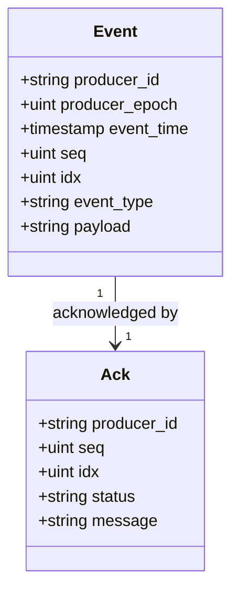

[FairGate](../README.md) › [Docs](README.md) › Event model and identity

# Event model and identity

## Event model

Events are represented as JSON with the following fields:

```json
{
  "producer_id": "sensor-01",
  "producer_epoch": 1,
  "event_time": "2026-10-02T08:00:00Z",
  "seq": 1,
  "idx": 0,
  "event_type": "temperature",
  "payload": "{\"value\":24.7}"
}
```

| Field | Type | Description |
|---|---|---|
| `producer_id` | string | Identifier of the event producer |
| `producer_epoch` | unsigned integer | Producer epoch, part of the event identity. Required. |
| `event_time` | timestamp | Event timestamp |
| `seq` | unsigned integer | Producer sequence number |
| `idx` | unsigned integer | Event index |
| `event_type` | string | Event category |
| `payload` | string | Event payload |

The decoder requires a non-empty producer ID, a producer epoch, a non-zero event time, and a non-empty event type.



The `message` field of an acknowledgment is optional.

## Event identity and idempotency

Every event has a stable identity made of four fields:

| Identity field | Role |
|---|---|
| `producer_id` | Which producer sent the event. |
| `producer_epoch` | Distinguishes producer incarnations, so identity stays unambiguous after a producer restarts and resets its sequence numbers. |
| `seq` | Producer sequence number. |
| `idx` | Event index. |

The server uses this identity to make producer retries safe:

- **New identity.** The event is appended to the WAL, and its identity is recorded only after that append succeeds. A failed WAL write therefore never leaves behind an identity that was not persisted.
- **Identical retry.** If the identity has been seen and the event time, type, and payload all match, the server acknowledges the retry without appending it to the WAL or enqueueing it again.
- **Conflicting reuse.** If the identity has been seen but the event time, type, or payload differs, the event is rejected.
- **Queue-level tracking.** Per-producer queues also track identities, so a duplicate is not enqueued twice.

The same identity is used downstream. The ClickHouse adapter computes `event_id` by hashing `producer_id`, `producer_epoch`, `seq`, and `idx` with an unambiguous encoding, so two different field combinations cannot produce the same input to the hash. See [Batch and event identity](storage.md#batch-and-event-identity).

A stored event can wait for a restart before processing. The server writes a new event to the WAL before enqueueing it. If shutdown cancels a handler while it is enqueueing, the WAL copy remains available for recovery, and because the identity has already been recorded, a retry in the same process lifetime is acknowledged as a duplicate. The event reaches the processing queue when recovery replays the WAL on the next startup.
