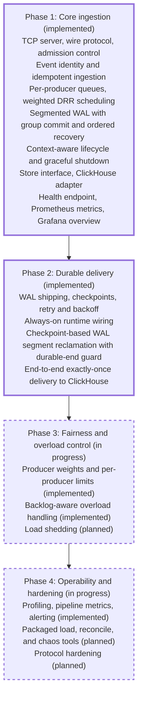

[FairGate](../README.md) › [Docs](README.md) › Roadmap

# Roadmap

The roadmap lists planned work in dependency order. Items are subject to change.

A solid border marks implemented work. Dashed borders mark planned work.

| Area | Status |
|---|---|
| Ingestion, validation, admission control | Implemented |
| Producer epochs, event identity, idempotent ingestion | Implemented |
| Per-producer queues, DRR scheduling | Implemented |
| Configuration file with environment overrides | Implemented |
| WAL append and recovery | Implemented |
| WAL segmentation and group commit | Implemented |
| Cross-segment recovery validation | Implemented |
| Sparse segment sets (discovery, recovery, reader) | Implemented |
| Context-aware lifecycle, connection tracking, graceful shutdown | Implemented |
| Cancelable enqueueing and scheduler error propagation | Implemented |
| `Store` interface, ClickHouse adapter | Implemented |
| Optional ClickHouse integration test | Implemented |
| TCP integration tests, CI race detection | Implemented |
| Durable WAL reader and checkpoint-based batch shipping | Implemented |
| Durable checkpoints and retry with backoff | Implemented |
| Stable batch tokens and deterministic event IDs | Implemented |
| Pending-batch intent and exact-range replay | Implemented |
| Exactly-once ClickHouse writes (existence check, row-bound token) | Implemented; single writer per event identity |
| Shipper runtime wiring and lifecycle | Implemented; shipper always runs |
| WAL segment reclamation | Implemented for segments older than the committed checkpoint segment |
| Durable-end guard on reclamation | Implemented (`ErrCheckpointAhead`); same-segment offset check planned |
| Docker image, Compose stack | Implemented |
| Health endpoint, basic Prometheus metrics, Grafana overview dashboard | Implemented |
| Producer weights and per-producer admission and queue limits | Implemented |
| Backlog-aware overload handling | Implemented |
| Profiling, pipeline metrics, alerting | Implemented |
| Packaged load generator, reconciliation, chaos tooling | Planned |
| Explicit queue-drain confirmation on shutdown | Planned |
| Protocol hardening (malformed and oversized frame handling) | Planned |
