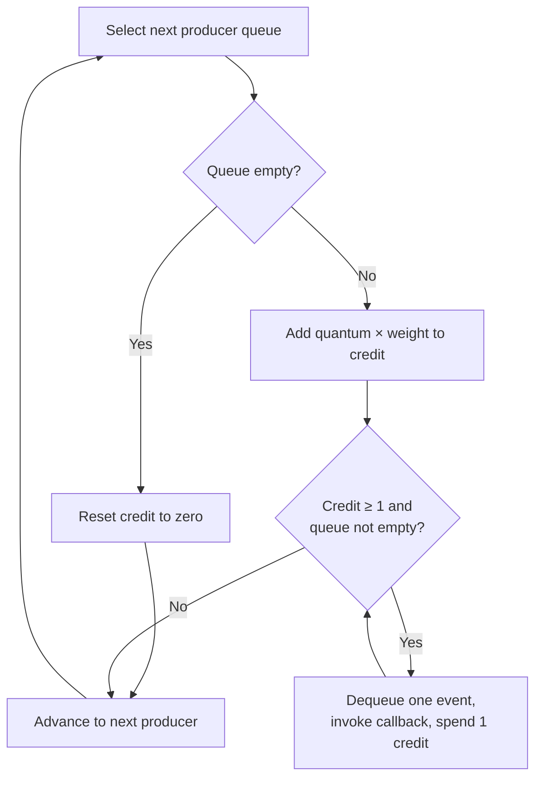
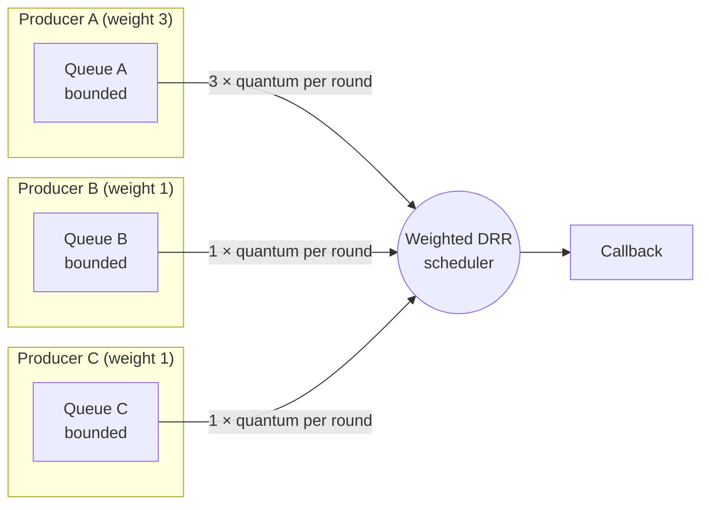

[FairGate](../README.md) › [Docs](README.md) › Backpressure, scheduling, and fairness

# Backpressure, scheduling, and fairness

FairGate keeps producers isolated at three stages: admission, buffering, and scheduling. Each stage has a default that applies to every producer and an optional per-producer override, set under `fairness.producers` in the [config file](configuration.md#fairness).

| Stage | Default | Per-producer override | Effect |
|---|---|---|---|
| Admission | `admission.rate`, `admission.burst` | `rate`, `burst` | Token-bucket limit on incoming events. Excess events get a `rejected` ACK with `rate_limited`. |
| Buffering | `queues.capacity` | `queue_capacity` | Events buffered for the producer before enqueueing blocks. |
| Scheduling | `fairness.default_weight` | `weight` | The producer's share of each DRR round. |

## Backpressure

Each producer has its own bounded queue, sized by `queues.capacity` (512 events by default) or by the producer's `queue_capacity`. Enqueueing blocks when a producer's queue is full, applying backpressure to the caller instead of allowing the queue to grow without bound. In the connection handler the wait is context-aware (`EnqueueContext`), so a blocked handler can stop waiting if shutdown is forced. Queues also track event identities so that a duplicate is not enqueued twice.

## Weighted deficit round robin

The scheduler visits producer queues in rounds. On each visit to a backlogged producer, it adds `quantum × weight` to that producer's credit (its deficit). It then serves one event per unit of credit until the credit drops below one or the queue empties. `scheduler.quantum` defaults to 8, and every producer's weight defaults to `fairness.default_weight` (1).

- **Shares are proportional to weight.** While two producers are both backlogged, one with weight 3 is served three times as many events as one with weight 1.
- **Fractional weights work.** Credit below one carries over to the next round while the producer stays backlogged. A weight of 0.5 with quantum 1 earns one event every second round.
- **Idle producers bank nothing.** A producer whose queue is empty has its credit reset to zero, as in classic DRR, so it cannot save up credit and later burst ahead of others.
- **Weights only matter under contention.** A producer alone in the gateway is served as fast as its queue fills, whatever its weight.

Each event costs one unit of credit regardless of its size. The scheduler is independent of event meaning, and its callback is responsible for downstream handling. At this beta stage, the callback only logs events; database delivery is handled by the separate WAL shipper.





Because each queue is separate and bounded, a high-rate producer fills only its own queue. Other producers continue to be served in each scheduling round, in proportion to their weights.

## Example

```yaml
admission:
  rate: 500
  burst: 1000

fairness:
  default_weight: 1
  producers:
    # A critical producer: a larger share of each round, a higher rate limit, and a deeper buffer.
    payments-service:
      weight: 4
      rate: 2000
      burst: 4000
      queue_capacity: 2048
    # A bulk producer that should only use spare capacity.
    batch-importer:
      weight: 0.25
      rate: 100
```

Producers not listed keep the defaults: 500 events per second with a burst of 1,000, a 512-event queue, and weight 1. Fields omitted from an entry also keep the defaults, so `batch-importer` above keeps a burst of 1,000 and a 512-event queue.

Overrides are keyed by `producer_id` and read at startup. Changing them needs a gateway restart.
