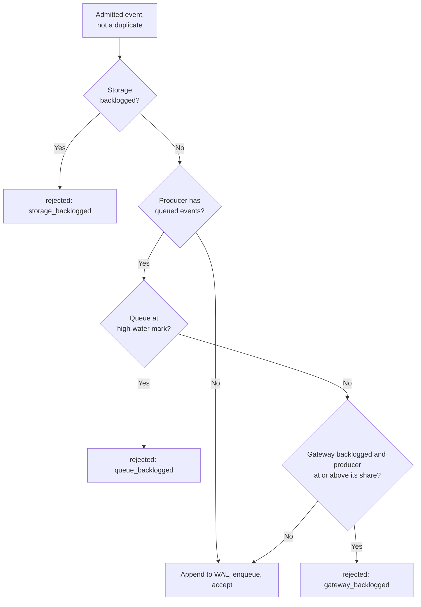
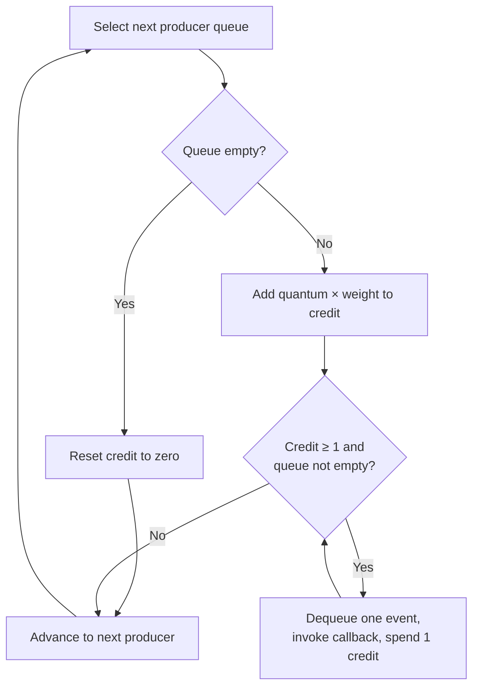
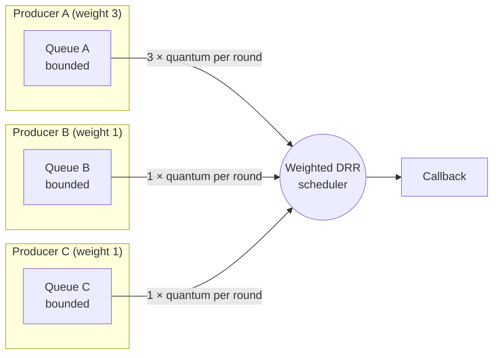

[FairGate](../README.md) › [Docs](README.md) › Backpressure, scheduling, and fairness

# Backpressure, scheduling, and fairness

FairGate keeps producers isolated at three stages: admission, buffering, and scheduling. Each stage has a default that applies to every producer and an optional per-producer override, set under `fairness.producers` in the [config file](configuration.md#fairness).

| Stage | Default | Per-producer override | Effect |
|---|---|---|---|
| Admission | `admission.rate`, `admission.burst` | `rate`, `burst` | Token-bucket limit on incoming events. Excess events get a `rejected` ACK with `rate_limited`. |
| Buffering | `queues.capacity` | `queue_capacity` | Events buffered for the producer. Past `overload.queue_high_water` of it, new events get a `rejected` ACK with `queue_backlogged`. |
| Scheduling | `fairness.default_weight` | `weight` | The producer's share of each DRR round. |

## Backpressure

Each producer has its own bounded queue, sized by `queues.capacity` (512 events by default) or by the producer's `queue_capacity`. Before a queue fills, [overload handling](#overload-handling) refuses the producer's new events with a retryable rejection, so the producer backs off instead of growing the queue. If a queue fills anyway, for example because several connections of one producer appended at once, enqueueing blocks until there is space. In the connection handler that wait is context-aware (`EnqueueContext`), so a blocked handler can stop waiting if shutdown is forced. Queues also track event identities so that a duplicate is not enqueued twice.

## Overload handling

Before appending an event to the WAL, the gateway checks three backlogs. If one is over its limit, the event gets a `rejected` ACK and is not persisted. The ACK's message names the backlog:

| Message | Backlog | Who is refused |
|---|---|---|
| `storage_backlogged` | The shipper trails the durable WAL end by at least `overload.max_shipper_lag_bytes`. | Every producer. |
| `queue_backlogged` | The producer's own queue holds at least `overload.queue_high_water` of its capacity. | That producer only. |
| `gateway_backlogged` | All producer queues together hold at least `overload.max_queued_events`. | Producers holding at least their weighted share of that total. |



- **Refused before the WAL.** A refused event is never persisted, so it does not add to the backlog it was refused for, and retrying it is always safe. Without this check, an event for a full queue was appended and then held without an ACK until space freed up.
- **Identical retries are still accepted.** The check runs only for new identities. A retry of an event that is already durable is acknowledged as a duplicate even while the gateway is backlogged, so a producer whose ACK was lost is not told to retry forever.
- **The gateway-wide queue limit is fair.** Producer IDs are chosen by clients, so the per-producer capacities alone do not bound the gateway's total. Past `max_queued_events`, a producer of weight `w` is refused only while it holds at least `w / W × max_queued_events` events, where `W` is the total weight of producers with queued events. A producer with a small backlog keeps being accepted while a heavy one is pushed back.
- **The storage limit bounds the WAL.** While ClickHouse is unavailable, the WAL keeps growing because segments are reclaimed only after delivery. `max_shipper_lag_bytes` caps that growth: past it, the gateway refuses all new events until delivery catches up.
- **Gateway-wide limits use hysteresis.** The total queued events and the shipper lag are sampled every `overload.sample_interval`. Each signal turns on at its limit and turns off only once its backlog drops below `overload.resume_ratio` of it, so a backlog hovering at the limit does not flap. A producer's own queue depth is read on every event.

Producers should treat `rejected` as a signal to back off and retry, as they already do for `rate_limited`. The `fairgate_events_overloaded_total` and `fairgate_overload_active` metrics show how often and why events are being refused. See [Observability](observability.md).

## Weighted deficit round robin

The scheduler visits producer queues in rounds. On each visit to a backlogged producer, it adds `quantum × weight` to that producer's credit (its deficit). It then serves one event per unit of credit until the credit drops below one or the queue empties. `scheduler.quantum` defaults to 8, and every producer's weight defaults to `fairness.default_weight` (1).

- **Shares are proportional to weight.** While two producers are both backlogged, one with weight 3 is served three times as many events as one with weight 1.
- **Fractional weights work.** Credit below one carries over to the next round while the producer stays backlogged. A weight of 0.5 with quantum 1 earns one event every second round.
- **Idle producers bank nothing.** A producer whose queue is empty has its credit reset to zero, as in classic DRR, so it cannot save up credit and later burst ahead of others.
- **Weights only matter under contention.** A producer alone in the gateway is served as fast as its queue fills, whatever its weight.

Each event costs one unit of credit regardless of its size. The scheduler is independent of event meaning, and its callback is responsible for downstream handling. The gateway's callback only counts and logs events; database delivery is handled by the separate WAL shipper.





Because each queue is separate and bounded, a high-rate producer fills only its own queue. Other producers continue to be served in each scheduling round, in proportion to their weights.

## Example

```yaml
admission:
  rate: 500
  burst: 1000

fairness:
  default_weight: 1
  producers:
    # A critical producer: a larger share of each round, a higher rate limit, and a deeper buffer.
    payments-service:
      weight: 4
      rate: 2000
      burst: 4000
      queue_capacity: 2048
    # A bulk producer that should only use spare capacity.
    batch-importer:
      weight: 0.25
      rate: 100
```

Producers not listed keep the defaults: 500 events per second with a burst of 1,000, a 512-event queue, and weight 1. Fields omitted from an entry also keep the defaults, so `batch-importer` above keeps a burst of 1,000 and a 512-event queue.

Overrides are keyed by `producer_id` and read at startup. Changing them needs a gateway restart.
