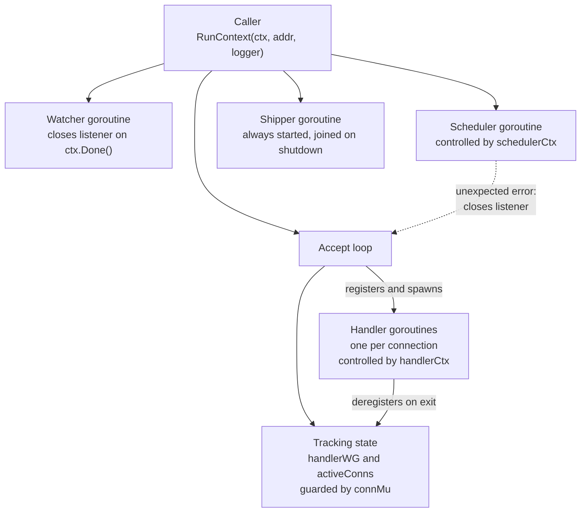
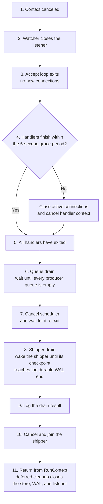

[FairGate](../README.md) › [Docs](README.md) › Server lifecycle and graceful shutdown

# Server lifecycle and graceful shutdown

`RunContext(ctx, addr, logger)` owns the server's lifetime. Cancelling `ctx` starts an orderly shutdown. `Run(addr, logger)` is retained as a wrapper that calls `RunContext` with `context.Background()`.

`RunContext` always constructs the ClickHouse store and starts the shipper. Startup is split so that the public entry point supplies the ClickHouse store to an inner startup path that accepts any `Store`; the graceful-shutdown tests use that path with a no-op `Store` and a temporary checkpoint path, so they do not need a live ClickHouse service.

## Goroutines and contexts



| Mechanism | Purpose |
|---|---|
| `handlerWG` | Counts active handler goroutines so the server can wait for them. |
| `activeConns` and `connMu` | Track live connections so they can be closed if handlers do not finish in time. |
| `handlerCtx` | Cancelled only when the grace period expires, to interrupt blocked enqueues. |
| `schedulerCtx` | Cancelled after handlers exit and the queue drain ends, so queued events keep being processed until the queues are empty. |
| Shutdown drain | After handlers exit, waits up to `server.drain_timeout` for the queues to empty and the shipper to catch up, then logs what it confirmed. |
| `schedulerDone` and `schedulerErr` | Signal scheduler exit and report unexpected scheduler failures without blocking. |
| Watcher and `watchStop` | Close the listener on cancellation, and let the watcher exit if the accept loop ends first. |

## Shutdown sequence



The ordering is deliberate. The WAL is closed only after every tracked handler has exited, so no handler can append to a closed log, and only after the shipper has stopped, so the shipper never reads from or reclaims in a closed log or writes to a closed store. Closing the WAL then drains queued append requests and synchronizes the active segment before the writer exits. The scheduler keeps running during the grace period so queued events continue to be processed while handlers drain.

## Queue-drain confirmation

Once every handler has exited, nothing new can reach the producer queues or the WAL, so both backlogs can only shrink. Before stopping anything, shutdown confirms they are empty, in two stages that share one deadline of `server.drain_timeout` (10 seconds by default):

1. **Queues.** Wait until the scheduler has taken every event out of every producer queue, then stop the scheduler.
2. **Shipper.** Wake the shipper repeatedly, so it does not wait for its next `shipper.poll_interval`, until its committed checkpoint reaches the WAL's durable end. At that point every acknowledged event is in ClickHouse.

The result is logged once:

| Log message | Level | Meaning |
|---|---|---|
| `Shutdown drain complete: producer queues are empty and every WAL record is in the store` | Info | Both stages finished. `queued_events_processed` and `shipped_bytes` say how much work the drain did. |
| `Shutdown drain incomplete; remaining events stay in the WAL ...` | Warn | The deadline passed (`timed_out`), or the scheduler or shipper had already stopped after an error (`stopped`). `queue_drain` and `shipper_drain` give each stage's outcome, and `queued_events_left` and `unshipped_bytes` say what is left. |
| `Shutdown drain skipped because server.drain_timeout is 0` | Info | The drain is disabled: the scheduler and shipper stop right after the handlers, as before. |

An incomplete drain loses nothing. Every queued or unshipped event was appended to the WAL before it was acknowledged, so the next start replays it into the queues and ships it from the checkpoint. What the drain adds is that a clean stop normally leaves nothing behind. When it cannot, for example during a ClickHouse outage, it times out and the WAL keeps the backlog.

Shutdown can therefore take up to `server.shutdown_grace_period` plus `server.drain_timeout`. Give the process manager at least that long before it kills the process: the Compose file sets `stop_grace_period: 30s`, and Docker's default is only 10 seconds.

## Behavior details

- **Closing a connection interrupts a blocked read.** Handlers waiting in `wire.ReadFrame()` exit once their connection is closed, instead of waiting indefinitely for the client.
- **Accept-loop errors are classified.** A closed listener or a canceled context is treated as normal shutdown. Any other listener error, or a scheduler failure, is returned to the caller.
- **Scheduler failure is fatal.** If the scheduler stops unexpectedly, the listener is closed and the error is returned from `RunContext`.
- **Select ordering.** If a queue send and context cancellation are ready at the same moment, Go's `select` may pick either. A handler may therefore enqueue one more event after cancellation.

## Embedding the server

From within the module, for example in a `cmd/` entry point:

```go
ctx, stop := signal.NotifyContext(context.Background(), os.Interrupt, syscall.SIGTERM)
defer stop()

cfg, err := config.Load("/etc/fairgate/fairgate.yaml") // "" for defaults plus environment overrides
if err != nil {
logger.Error("invalid configuration", "error", err)
return
}

if err := server.RunConfig(ctx, cfg, logger); err != nil {
logger.Error("server stopped", "error", err)
}
```

`RunConfig` takes every setting from the resolved `config.Config`; see [Configuration](configuration.md). `RunContext(ctx, addr, logger)` is still available: it uses the defaults and environment overrides with the given listen address. In both cases the shipper always starts with a ClickHouse store built from the `clickhouse` settings. The Docker Compose stack publishes port `9001`; see [Docker deployment](deployment.md).

## Limitations

- The five-second grace period bounds the wait before forced connection closure. It does not guarantee that shutdown completes within five seconds, because a handler blocked in an operation that responds to neither connection closure nor context cancellation could still delay it.
- The queue drain confirms that the scheduler took every event, not that anything downstream used it: the scheduler callback only counts and logs events. Delivery to ClickHouse is confirmed by the shipper drain, which follows the WAL, not the queues.
- An event appended to the WAL whose handler was canceled before it enqueued it is not in any queue, so the queue drain does not wait for it. The shipper drain still ships it.
- An event that was appended to the WAL but not yet enqueued when shutdown canceled its handler is not processed by the live scheduler. It is recovered on the next startup, and in the meantime a retry of it is acknowledged as a duplicate.
- The server always stops and joins the shipper during shutdown before closing the store and WAL. Events not yet shipped at that point stay in the WAL and are picked up from the checkpoint on the next start.
