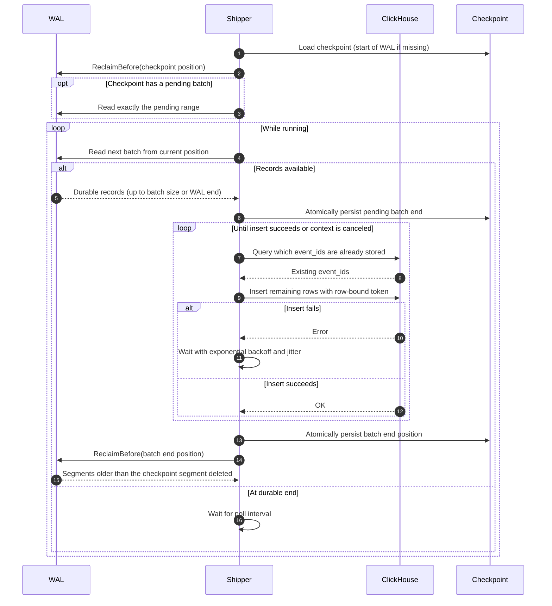

[FairGate](../README.md) › [Docs](README.md) › Storage integration

# Storage integration

ClickHouse is the initial storage backend. The `Store` interface, ClickHouse adapter, always-on WAL shipper, and checkpoint-based reclamation of fully shipped WAL segments are implemented. Because the public entry point always constructs the ClickHouse store, a ClickHouse instance must be configured for every gateway run.

## Current building blocks

| Component | Behavior |
|---|---|
| Shipper | Reads from the WAL at the saved position, forms batches up to `BatchSize`, derives a stable batch token, and inserts the batch through the `Store`. `Run(ctx)` polls for newly durable records and runs until its context is canceled. |
| Retry policy | Retries insertion errors with exponential backoff capped at a maximum delay, optional symmetric jitter, and context-aware cancellation. |
| Checkpoint | JSON segment and byte offset, plus an optional `pending` batch end. Missing files mean the beginning of the WAL. Each write syncs a temporary file, atomically renames it, and syncs the directory. The pending end is written before each insert and cleared by the commit after it. |
| Reclamation | After each checkpoint commit, and once at startup against the checkpoint on disk, calls `WAL.ReclaimBefore`. Rejects checkpoints beyond the durable end with `ErrCheckpointAhead`. Otherwise deletes only segments with IDs strictly less than the checkpoint segment, keeping the checkpoint and active segments, serialized with rotation, with a directory sync afterward. |
| `Store` interface | `InsertBatch(ctx, token, events)` and `Close()`. Backends plug in without changes to the shipper. |
| ClickHouse adapter | Official Go client, configurable authentication, `Ping` health check, batched inserts with `PrepareBatch` and `Send`, graceful close. Skips events whose `event_id` is already stored, and sends a token bound to the exact rows inserted. |
| Integration tests | Run only when `CLICKHOUSE_ADDR` is set. They validate connectivity, batch insertion, retrieval, and re-insertion under the same and different tokens. They also cover a full WAL, shipper, and ClickHouse run through a crash before checkpoint commit, a restart, and a lost checkpoint, checking that each event appears exactly once. |

> [!NOTE]
> **Database delivery is exactly-once per event identity.** The shipper resumes from its checkpoint, replays any pending batch over exactly its original range, and retries insertion failures. A batch submitted again after a crash is filtered against the events already stored, so it adds no duplicate rows. This assumes a single gateway writes each event identity; see [Delivery semantics](delivery-semantics.md). Segments older than the committed checkpoint segment are reclaimed, so the WAL is not a permanent archive of every event.

## Shipper ordering

Producer acknowledgments remain based on WAL durability. The shipper loads its checkpoint and reclaims segments already behind it. If the checkpoint holds a pending batch, the shipper replays exactly that range first. It then reads batches from the current position up to the durable WAL end. For each batch, it records the batch end as pending, delivers the batch to the store, commits the checkpoint, and reclaims segments behind it. At the durable end it polls for later appends.

## Batch and event identity

Each batch is identified by a SHA-256 token computed from the WAL positions where the batch starts and ends. Durable WAL records do not move, so the same batch produces the same token on every retry and after every restart. The shipper passes that token to `Store.InsertBatch` with the batch.

Each row also carries an `event_id` computed from `producer_id`, `producer_epoch`, `seq`, and `idx`. The fields are encoded unambiguously before hashing, so different field combinations cannot collide through concatenation, and an event has the same identifier wherever it is written. This is the same identity the server uses for [idempotent ingestion](event-model.md#event-identity-and-idempotency).

The adapter rejects an empty token for a non-empty batch, so every batch that reaches ClickHouse has one. Before inserting, it keeps the first event for each `event_id` in the batch and queries which of those IDs are already stored. It then inserts only the rest. The `insert_deduplication_token` it sends is a SHA-256 of the batch token and the IDs of the rows being sent. Identical rows produce an identical token. As a result, an insert that was still in flight during a crash is discarded by ClickHouse when the replay sends the same rows. A smaller replay gets a different token, so ClickHouse does not discard it as a repeat of the original block.

The existence check, not the deduplication window, is what makes storage exactly-once. The window (`non_replicated_deduplication_window = 1000`) only needs to cover the most recent inserts, for the in-flight case.

## Duplicate handling

A crash between a successful insert and the checkpoint write leaves the batch recorded as pending. After the restart, the shipper submits the same WAL range again with the same token, and the adapter skips the events that were already stored. This also covers inserts that landed only partly. Other duplicates are caught the same way, by `event_id`:

- a lost or rewound checkpoint that re-ships older batches;
- a producer resend whose original identity was forgotten by the in-memory deduplication manager after its segment was reclaimed.

The schema's `ReplacingMergeTree` ordered by `event_id` remains as a further safeguard, but correctness no longer depends on merges.

## Schema

The adapter persists events into the `fairgate.events` table, which uses `ReplacingMergeTree`, monthly partitioning, and a 30-day TTL. Persisted fields include `event_id`, the producer ID, `producer_epoch`, event timestamp, sequence number, index (`UInt64`), event type, and payload. Records are ordered by `event_id`. The `received_at` column has been removed. The schema sets `non_replicated_deduplication_window = 1000`, which controls how much insert deduplication history ClickHouse keeps for non-replicated MergeTree inserts. Refer to `deploy/clickhouse/schema.sql` for the exact columns, partition expression, TTL clause, and deduplication setting.

> [!WARNING]
> The schema file uses `CREATE TABLE IF NOT EXISTS`. Editing it does not add `producer_epoch` or change the sorting key on a table that already exists, so existing installations must migrate their table (or create a new one and copy the data) before running this version.
