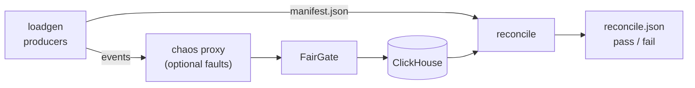

[FairGate](../README.md) › [Docs](README.md) › Load, reconcile, and chaos tools

# Load, reconcile, and chaos tools

FairGate ships three commands for checking a deployment under load and under failure:

| Command | Does |
|---|---|
| [`loadgen`](#load-generator) | Drives the gateway with simulated producers and records what happened to every event. |
| [`reconcile`](#reconciliation) | Checks that record against ClickHouse: every accepted event stored exactly once, and nothing else. |
| [`chaos`](#chaos-tooling) | A fault-injecting TCP proxy, and a scenario runner that combines load, timed faults, and reconciliation. |



Build them, or run them with `go run`:

```bash
go build -o bin/ ./cmd/loadgen ./cmd/reconcile ./cmd/chaos
```

The examples below assume the Compose stack from the [quick start](../README.md#quick-start) is running, so the gateway listens on `127.0.0.1:9001` and ClickHouse on `127.0.0.1:9000`.

## Load generator

```bash
go run ./cmd/loadgen -producers 200 -events 2000 -rate 100 -window 4
```

Each producer opens one TCP connection, negotiates the protocol version with a hello (or skips it with `-legacy`, to act like an older client), and sends events. The producers share one `producer_epoch`, unique per run, so the events of one run never collide with another's. Event `seq` numbers start at 1 for each producer, and `idx` is always 0.

How a producer behaves:

- **Pipelining.** Up to `-window` events are in flight on a connection. The gateway answers a connection's frames in order, so each ACK is matched to its event.
- **Pacing.** `-rate` limits each producer to that many new events per second. A producer that falls behind catches up by at most one second's worth.
- **Retries keep the identity.** An event's encoded frame is kept until it is resolved, so every retry is byte-identical and the gateway acknowledges a retry of a persisted event as a duplicate.
  - `rejected` (rate limited or backlogged): retried after an exponential backoff with ±20% jitter, capped at `-max-backoff`. The producer sends nothing new while it backs off.
  - `error`, a dropped connection, or no ACK within `-ack-timeout`: the producer reconnects and resends every in-flight event.
  - `invalid`: recorded and not retried.
- **Noisy neighbours.** `-hot N` makes the first N producers send with `-hot-rate` and `-hot-window` instead, so you can see how much they affect everyone else.
- **Malformed frames.** `-malformed-ratio` sends an extra undecodable frame after that fraction of events. The gateway should answer each one `invalid` and keep the connection open.

A run ends when every producer has sent `-events` events, or when `-duration` passes, whichever comes first. Producers then keep retrying outstanding events for up to `-drain-timeout`. Ctrl+C stops new events and drains; a second Ctrl+C exits at once. Without `-duration`, a run against a gateway that never comes up keeps redialling until it is stopped.

### Flags

| Flag | Default | Meaning |
|---|---|---|
| `-addr` | `127.0.0.1:9001` | Gateway ingestion address. |
| `-producers` | `50` | Producers, one connection each. |
| `-events` | `1000` | Events per producer. `0` sends until `-duration`. |
| `-duration` | `0` | How long to send new events. `0` sends until `-events`. |
| `-rate` | `0` | New events per second per producer. `0` is unpaced. |
| `-window` | `1` | Events in flight per connection. |
| `-payload-bytes` | `256` | Minimum payload size. Payloads are padded deterministically. |
| `-event-type` | `loadgen` | `event_type` of every event. |
| `-prefix` | `loadgen` | Producer IDs are `<prefix>-0001`, `<prefix>-0002`, and so on. |
| `-epoch` | unique per run | `producer_epoch` of every event. |
| `-ramp` | `0` | Spread producer starts evenly across this period. |
| `-hot`, `-hot-rate`, `-hot-window` | `0`, `0`, `32` | Number of hot producers, and their rate and window. |
| `-malformed-ratio` | `0` | Probability of an extra malformed frame after each event. |
| `-ack-timeout` | `10s` | Reconnect when the oldest in-flight event waits this long. |
| `-dial-timeout` | `5s` | TCP connect timeout. |
| `-max-backoff` | `2s` | Cap on retry and reconnect backoff. |
| `-drain-timeout` | `60s` | Time after sending stops to finish outstanding events. |
| `-seed` | `1` | Seed for jitter and malformed frames. |
| `-legacy` | `false` | Skip the protocol handshake, as clients written before protocol versioning do. |
| `-out` | `benchmarks/loadgen-<timestamp>` | Results directory. |

### Output

| File | Contents |
|---|---|
| `summary.json` | Settings, totals per ACK status and message, accepted throughput, ACK and delivery latency percentiles (all, normal, and hot producers), and Jain's fairness index over the normal producers' throughput. |
| `manifest.json` | The outcome of every event, for `reconcile`. |
| `producers.csv` | Per-producer counts, throughput, and ACK latency percentiles. |
| `timeseries.csv` | Per-second sent, accepted, rejected, invalid, and error counts, with ACK latency percentiles. |

ACK latency runs from an event's last send to its accepted ACK. Delivery latency runs from its first send, so it includes retries and backoff.

The manifest lists, per producer, the `seq` ranges in each outcome:

| Outcome | Meaning | Storage must hold |
|---|---|---|
| `accepted` | The gateway ACKed it as accepted (new or duplicate). | Exactly one row. |
| `unacked` | Sent, but no accepted or invalid ACK arrived before the run ended. | At most one row: the gateway may have persisted it and lost the ACK. |
| `invalid` | The gateway refused it as invalid. | No row. |
| not listed | Never sent. | No row. |

## Reconciliation

```bash
go run ./cmd/reconcile -manifest benchmarks/loadgen-20261030-120000/manifest.json -verify-content
```

`reconcile` reads ClickHouse settings the same way the gateway does: built-in defaults, then the file given by `-config` (or `FAIRGATE_CONFIG`), then the `CLICKHOUSE_*` environment variables. The `-clickhouse-*` flags override all of them. It queries `fairgate.events`, the table the gateway's adapter writes to; `-table` changes that.

Accepted events reach ClickHouse only after the shipper catches up, so `reconcile` first waits, polling a cheap distinct count every `-poll` until enough identities are stored or `-timeout` passes. It then scans every stored identity of the run's producers and epoch and reports:

| Result | Violation? |
|---|---|
| `missing`: accepted but not stored | Yes: an acknowledged event was lost. |
| `duplicated`: stored in more than one row | Yes: exactly-once was broken. |
| `unexpected`: stored but never sent, refused as invalid, or with an `idx` other than 0 | Yes. |
| `mismatched`: stored with an `event_type` or payload other than what was sent (`-verify-content` only) | Yes. |
| `stored_unacked`: unacked but stored once | No, counted for information. |

It writes `reconcile.json` next to the manifest (or to `-out`), prints a summary with the offending `seq` ranges, and exits `0` when the run reconciles, `1` when it finds a violation, and `2` when it cannot check (for example, ClickHouse is unreachable).

Rows are counted as stored, without `FINAL`. The table is a `ReplacingMergeTree` ordered by `event_id`, so a background merge can collapse duplicate rows of one identity; a duplicate merged away before `reconcile` runs is not detected. Run it soon after the load.

## Chaos tooling

### Fault proxy

```bash
go run ./cmd/chaos proxy -listen 127.0.0.1:9101 -upstream 127.0.0.1:9001 -latency 20ms
go run ./cmd/loadgen -addr 127.0.0.1:9101 -duration 60s -rate 50
```

The proxy forwards each connection to `-upstream` and applies these faults in both directions:

| Fault | Flag | Effect |
|---|---|---|
| `latency`, `jitter` | `-latency`, `-jitter` | Delay each chunk of data by `latency` plus up to `jitter`. Order is preserved, and delay does not cap throughput. |
| `fragment`, `fragment_delay` | `-fragment`, `-fragment-delay` | Split forwarded data into writes of at most `fragment` bytes, pausing `fragment_delay` between them so the receiver sees them separately. Exercises frame reassembly. |
| `reset_probability` | `-reset-prob` | Each chunk resets its connection (RST to both ends) with this probability. |
| `blackhole` | `-blackhole` | Hold all data, as a network partition does, until cleared. Connections stay open. |
| `refuse` | `-refuse` | Reset new connections as soon as they are accepted. |

The admin API (on `-admin`, default `127.0.0.1:9102`) changes faults while traffic flows:

```bash
curl -X PUT -d '{"reset_probability":0.01,"latency":"50ms"}' http://127.0.0.1:9102/faults
curl -X PUT -d '{"blackhole":true}' http://127.0.0.1:9102/faults
curl -X PUT -d '{}' http://127.0.0.1:9102/faults
curl -X POST http://127.0.0.1:9102/disconnect
curl http://127.0.0.1:9102/stats
```

`PUT /faults` replaces every fault, so `{}` clears them.

To fault the gateway's connection to ClickHouse instead, run the proxy in front of ClickHouse and point the gateway's `clickhouse.addr` at it.

### Scenarios

```bash
go run ./cmd/chaos run deploy/chaos/gateway-crash.yaml
```

A scenario is a YAML file with a load, optional proxy, timed steps, and a reconciliation. The runner starts the load, runs each step at its offset from the start of the load, waits for the load to drain, reconciles the run, and writes `chaos-report.json` beside the loadgen files and `reconcile.json` in `-out` (default `benchmarks/chaos-<name>-<timestamp>`). It exits `0` when the scenario passes, `1` when it fails, and `2` when it cannot run.

The repository includes three scenarios for the Compose stack:

| Scenario | Fault | Checks |
|---|---|---|
| [`gateway-crash.yaml`](../deploy/chaos/gateway-crash.yaml) | `SIGKILL` the gateway container twice mid-load, restarting it each time. | WAL durability and recovery, deduplication of producer retries after a restart, shipper replay. |
| [`clickhouse-outage.yaml`](../deploy/chaos/clickhouse-outage.yaml) | Stop ClickHouse for 30 seconds under load. | The WAL absorbs the outage and the shipper catches up with nothing lost or doubled. |
| [`network-faults.yaml`](../deploy/chaos/network-faults.yaml) | Latency and jitter, fragmented writes, random resets, a partition, a mass disconnect, and refused connections, through the proxy. | Producer retries over a hostile network still store every event once. |

The container steps use the names from `docker-compose.yml` (`fairgate-server`, `fairgate-clickhouse`).

```yaml
name: gateway-crash
load:                      # loadgen settings; omitted fields keep the loadgen defaults
  addr: 127.0.0.1:9001
  producers: 50
  events: 1000
  rate: 50
  window: 4
  drain_timeout: 90s
proxy:                     # optional: route the load through a fault proxy
  listen: 127.0.0.1:9101   # default: an ephemeral loopback port
  upstream: 127.0.0.1:9001 # default: load.addr
  faults: {latency: 5ms}
steps:
  - name: kill gateway
    at: 8s                 # offset from the start of the load
    exec: docker kill --signal KILL fairgate-server
  - name: restart gateway
    at: 10s
    exec: docker start fairgate-server
    always: true           # run even after a failed step or Ctrl+C
  - at: 10s
    wait_healthy: http://127.0.0.1:9100/health
    timeout: 90s
reconcile:
  config: deploy/fairgate.yaml   # optional: read ClickHouse settings from a gateway config
  timeout: 3m
  verify_content: true
expect:
  min_accepted_ratio: 1.0  # fail unless every generated event was eventually accepted
```

| Step key | Meaning |
|---|---|
| `at` | When the step starts, measured from the start of the load. Steps run in file order, and `at` may not decrease. |
| `exec` | Shell command, run with `sh -c`. Its last 2 KiB of output go into the report. |
| `wait_healthy` | URL polled every 500 ms until it answers `2xx`. |
| `faults` | Replace the proxy's faults; `{}` clears them. Needs a `proxy` section. |
| `disconnect` | Reset every proxied connection. Needs a `proxy` section. |
| `timeout` | Limit for `exec` (default 2 minutes) and `wait_healthy` (default 60 seconds). |
| `ignore_error` | A failure of this step does not fail the scenario. |
| `always` | Run even after an earlier step failed or the run was interrupted, like a `finally` block. Use it for steps that restore the system. |

Each step sets exactly one of `exec`, `wait_healthy`, `faults`, and `disconnect`. When a step fails, later steps are skipped except `always` steps, the load still runs to the end, and the scenario fails. The `reconcile` section takes the same ClickHouse settings as the `reconcile` command (`config`, `addr`, `database`, `username`, `password`, `table`), plus `timeout`, `verify_content`, and `skip`.

A scenario fails when a step fails (without `ignore_error`), when fewer than `expect.min_accepted_ratio` of generated events were accepted by the end of the drain, or when reconciliation finds a violation.

Scenario `exec` steps run arbitrary shell commands with your permissions. Read a scenario before running it.

## Tests

The tools are tested without Docker:

- `internal/loadgen` runs producers against a scripted gateway that rejects, drops connections after persisting, and answers malformed frames.
- `internal/reconcile` checks every violation type against an in-memory source. With `CLICKHOUSE_ADDR` set, an integration test reconciles rows written by the gateway's own adapter.
- `internal/chaos` tests each proxy fault, the admin API, scenario validation, and step failure handling, and checks that the scenarios in `deploy/chaos/` parse.
- `internal/server` runs the real gateway with an in-memory store: one test restarts it mid-load and reconciles, and another runs a full scenario of proxy faults against it.
