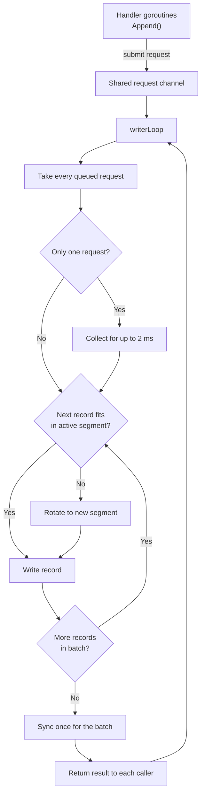
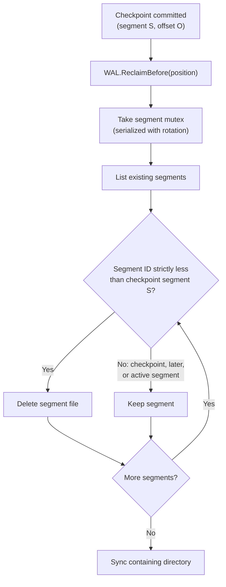
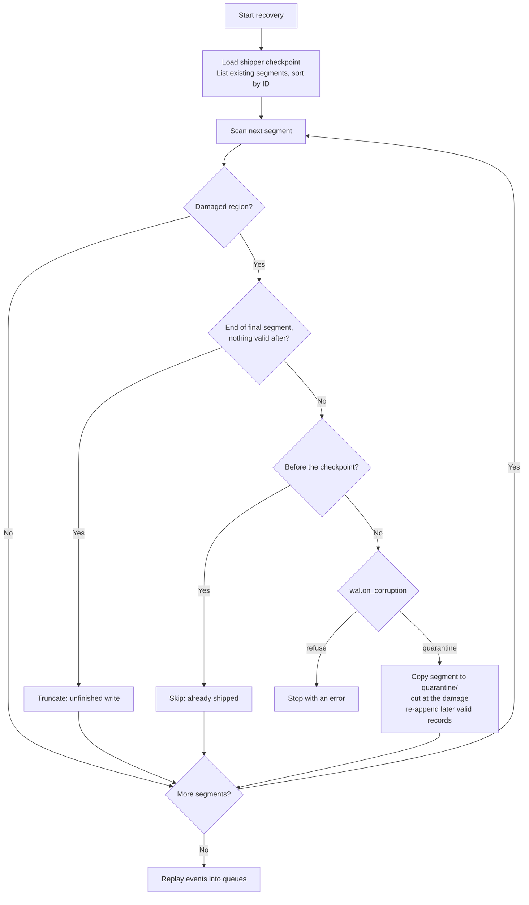

[FairGate](../README.md) › [Docs](README.md) › Write-Ahead Log

# Write-Ahead Log

The WAL stores serialized event records. Each record starts with a fixed marker (the record magic), then a length field and a CRC32 checksum. All integers are big-endian.

```text
+--------------+--------------+----------------------------+---------------------------+
| Magic "FGW1" | Length       | CRC32 of length and event  | Serialized event (JSON)   |
| 4 bytes      | 4 bytes      | 4 bytes                    | Length bytes, up to 1 MiB |
+--------------+--------------+----------------------------+---------------------------+
```

The magic lets recovery find the next record after a damaged one instead of giving up on the rest of the segment. The checksum covers the length as well as the event, so a damaged length is detected instead of being read as a different record boundary.

### Legacy records

Segments written before the magic was added hold legacy records: `Length | CRC32 of event | event`. They stay readable. A segment is in the current format when it starts with the magic, which a legacy segment cannot do, because its first bytes are a record length of at most 1 MiB. Every record in a segment has the same format: when the gateway starts and its newest segment holds legacy records, it leaves that segment as it is and writes to a new one. Recovery cannot resynchronize inside a legacy segment, so damage there is handled as if it ran to the end of the segment.

## Segments

The log is stored as multiple segment files rather than one growing file. Each segment holds a sequence of records in the format above. The segment size is configurable. Before writing a record, the writer checks whether it would push the active segment past the limit, and if so rotates to a new segment first.

A position in the log is identified by a segment ID and a byte offset within that segment. The shipper uses these positions for its checkpoint.

Segment IDs increase as the writer rotates, but the set of segments on disk is not necessarily contiguous, because reclamation deletes old segments. Discovery therefore lists only the files that exist and sorts them by ID, and nothing in the WAL assumes that consecutive IDs are present.

## Writer and group commit

A dedicated `writerLoop` goroutine owns all WAL file operations. Callers of `Append()` submit a request to a shared channel and wait for the result, rather than writing to disk themselves. The writer collects requests into a batch, writes the records, and performs one `Sync()` for the whole batch. Every caller in the batch is then released, so no `Append()` returns before its record has been synchronized.

Batches are formed as follows:

- The writer takes every request already waiting in the channel. These arrived while the previous batch was being written and synchronized, so they share the next `Sync()` with no extra wait.
- Batches have no size limit. Under load, one `Sync()` covers every waiting caller, so an append waits about one `Sync()` however many handlers are appending.
- Only a request that arrives alone waits for others: the writer collects for up to 2 ms before writing, so light traffic can still share a `Sync()`.



Creating a segment, at rotation or failover, also syncs the WAL directory before any record is written to the segment. Without it, a crash could lose the new segment's directory entry even though its records were synced and acknowledged.

### Write and sync failures

If a write, rotation, or sync fails, the writer does not retry the sync on the same file. After a failed `fsync`, Linux can drop the unwritten pages and report a later `fsync` of that file as successful (the PostgreSQL "fsyncgate" problem), so a retry could acknowledge records that are not on disk. Instead the writer fails over:

1. It truncates the active segment back to its durable end, the end of the last synced batch, and closes it. Nothing past that point was acknowledged.
2. It creates the next segment and syncs the directory.
3. It writes the whole failed batch to the new segment and syncs it. If that works, the batch's callers get success, and `fairgate_wal_failovers_total` goes up.

If the batch spanned a rotation, a synced copy of part of it may remain in the earlier segment. That is harmless: replay, deduplication, and the store all treat an identical record as a duplicate.

If any step of the failover fails (a full or dead disk), the WAL becomes **degraded**:

- Appends fail with `wal.ErrUnavailable`, and the gateway answers events with a retryable `rejected` / `storage_unavailable` ACK. The connection stays open.
- `/ready` returns `503`, so a load balancer can send producers elsewhere. `/health` still returns `200`.
- `fairgate_wal_degraded` is `1`, and the `FairGateWALDegraded` alert fires.
- The shipper keeps running. Shipping and reclaiming segments is what frees disk space.
- Every second the writer retries the failover without a batch. When it works, appends resume.
- If the WAL is still degraded after `wal.degraded_exit_after` (1 minute by default), the gateway shuts down and exits with status `3`, so a supervisor can restart it. Startup recovery then cuts the failed segment back. Set it to `0` to stay up and degraded instead.

Closing the WAL stops new submissions, lets queued requests finish, then synchronizes and closes the active segment before the writer exits.

## Segment reclamation

Once the shipper has committed a checkpoint, segments that lie entirely before it are no longer needed. After each successful `Store.InsertBatch`, the shipper atomically commits the batch's end position and then calls `WAL.ReclaimBefore` with that position. At startup it also reclaims against the checkpoint already on disk, so segments left over from an earlier run are removed as well.

The deletion rules are conservative:

- Only segments whose IDs are strictly less than the checkpoint segment are deleted.
- A checkpoint in a segment beyond the durable end is rejected with `ErrCheckpointAhead`, and nothing is deleted.
- The checkpoint segment is retained, because the checkpoint offset may still leave records in it to ship.
- The active segment is always retained.
- Reclamation is serialized with rotation through a segment mutex, so a segment is not deleted while the writer is rotating.
- The containing directory is synced after deletion so the removals are durable.



Because the checkpoint is committed before reclamation runs, a crash between the two can only leave extra segments behind. It cannot remove records that have not been shipped. Reclamation works on whole segments, so shipped records in the checkpoint segment stay on disk until a later checkpoint moves past it.

## Recovery

On startup the WAL lists the segment files that exist, sorts them by ID, and scans them in order, record by record. The final segment is the highest-numbered one on disk, and a sparse set left behind by reclamation is handled without error.

A record is bad if its header or payload is incomplete, its magic is missing, its length is invalid, its checksum does not match, or its payload is not an event. A bad record starts a **damaged region**, which ends at the next valid record or at the end of the segment. Recovery decides what to do with each region from where it is and from the shipper's committed checkpoint, which is loaded before recovery:

| Region | Action | Data lost |
|---|---|---|
| At the end of the final segment, with nothing valid after it (for legacy records: the bad record runs into the end of the file) | `truncated_tail`: cut off. It is a write that was never acknowledged, because acknowledgement follows the sync. | None |
| Entirely before the shipper's checkpoint | `skipped_shipped`: left in place and skipped. Its records are already in ClickHouse, and reclamation deletes the segment later. | None |
| Anywhere else, with `wal.on_corruption: refuse` (the default) | Startup fails with an error naming the segment, byte range, and reason. | Nothing yet |
| Anywhere else, with `wal.on_corruption: quarantine` | `quarantined`: the segment is copied to `quarantine/` next to the WAL, then cut at the start of the damage. Valid records found after the damage in that segment are appended to the WAL again, so they are still shipped. | The records inside the damaged bytes |

Damage before records that follow it in the same segment was acknowledged data, not an unfinished write, which is why only a region at the very end of the final segment is cut off automatically. Each region is logged, quarantined ones at error level, and counted in `fairgate_wal_recovery_damage_regions{action}`. A quarantined region also fires the `FairGateWALDataQuarantined` alert. If the checkpoint itself lies inside a damaged region, quarantining cannot honour it, and startup fails even with the quarantine policy.



### Inspecting and repairing

The gateway binary has two commands for the WAL of a stopped gateway. Both read `wal.path` and `shipper.checkpoint_path` from the config file (`-config` or `FAIRGATE_CONFIG`), or take `-wal` and `-checkpoint` directly, and print JSON with `-json`.

```bash
fairgate wal inspect -config /etc/fairgate/fairgate.yaml
fairgate wal repair -config /etc/fairgate/fairgate.yaml
```

- `inspect` changes nothing. For every segment it lists the format, size, number of valid records, and each damaged region with what startup would do with it. It exits `0` if startup would succeed, `1` if startup would refuse, and `2` on error.
- `repair` applies the quarantine policy once: it quarantines damage that has not been shipped and appends the salvaged records, so the next start succeeds with `wal.on_corruption: refuse` still in place. Stop the gateway before running it.

In Docker Compose, run them in a one-off container that shares the WAL volume while the gateway is stopped:

```bash
sudo docker compose stop fairgate
sudo docker compose run --rm fairgate wal inspect
```

Recovered events are replayed into the producer queues. Replay covers only the segments still on disk, so records in reclaimed segments are not replayed. The scheduler is started before replay so that it consumes events while the queues fill, which avoids a startup deadlock when a producer has more recovered events than its queue capacity.

## Durable reader

The shipper reads the WAL through a reader that stops at the WAL's synchronized durable end, so it never returns a record that has not been synced. For each record it verifies the length, CRC32, and JSON, and returns the event together with its start and end positions. At the end of a segment it advances to the next segment that exists, rather than assuming IDs are contiguous, and it can begin at any saved position.
