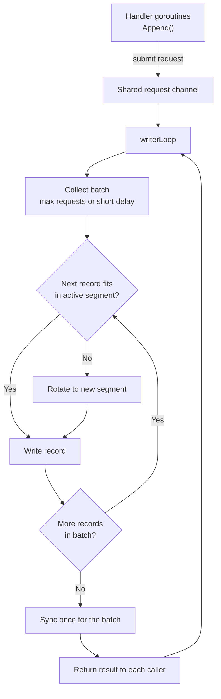
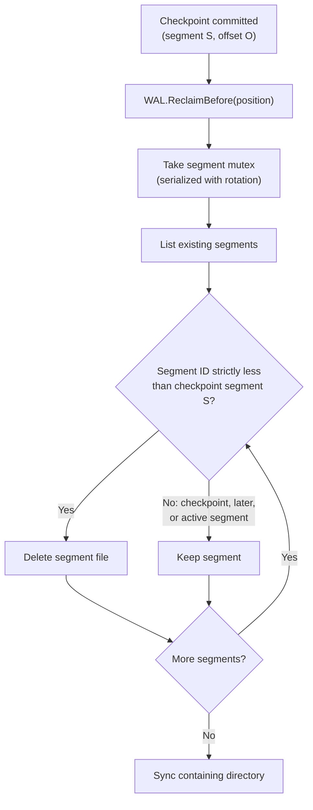
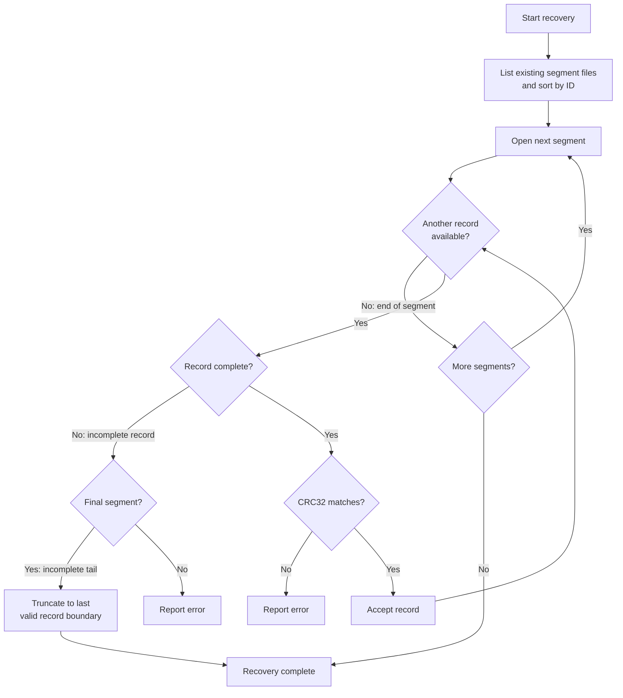

[FairGate](../README.md) › [Docs](README.md) › Write-Ahead Log

# Write-Ahead Log

The WAL stores serialized event records with a length field and a CRC32 checksum. The layout below is conceptual and is unchanged by segmentation, group commit, and reclamation. Refer to the `wal` package for the exact encoding.

```text
+----------------+----------------+---------------------------+
| Length         | CRC32          | Serialized event          |
+----------------+----------------+---------------------------+
```

## Segments

The log is stored as multiple segment files rather than one growing file. Each segment holds a sequence of records in the format above. The segment size is configurable. Before writing a record, the writer checks whether it would push the active segment past the limit, and if so rotates to a new segment first.

A position in the log is identified by a segment ID and a byte offset within that segment. The shipper uses these positions for its checkpoint.

Segment IDs increase as the writer rotates, but the set of segments on disk is not necessarily contiguous, because reclamation deletes old segments. Discovery therefore lists only the files that exist and sorts them by ID, and nothing in the WAL assumes that consecutive IDs are present.

## Writer and group commit

A dedicated `writerLoop` goroutine owns all WAL file operations. Callers of `Append()` submit a request to a shared channel and wait for the result, rather than writing to disk themselves. The writer collects requests into a batch, bounded by a maximum request count and a short collection delay, writes the records, and performs one `Sync()` for the whole batch. Every caller in the batch is then released, so no `Append()` returns before its record has been synchronized.



If a write, rotation, or sync fails, the error is recorded as fatal. Requests in the affected batch receive an error, and later batches are rejected instead of being reported as persisted.

Closing the WAL stops new submissions, lets queued requests finish, then synchronizes and closes the active segment before the writer exits.

## Segment reclamation

Once the shipper has committed a checkpoint, segments that lie entirely before it are no longer needed. After each successful `Store.InsertBatch`, the shipper atomically commits the batch's end position and then calls `WAL.ReclaimBefore` with that position. At startup it also reclaims against the checkpoint already on disk, so segments left over from an earlier run are removed as well.

The deletion rules are conservative:

- Only segments whose IDs are strictly less than the checkpoint segment are deleted.
- A checkpoint in a segment beyond the durable end is rejected with `ErrCheckpointAhead`, and nothing is deleted.
- The checkpoint segment is retained, because the checkpoint offset may still leave records in it to ship.
- The active segment is always retained.
- Reclamation is serialized with rotation through a segment mutex, so a segment is not deleted while the writer is rotating.
- The containing directory is synced after deletion so the removals are durable.



Because the checkpoint is committed before reclamation runs, a crash between the two can only leave extra segments behind. It cannot remove records that have not been shipped. Reclamation works on whole segments, so shipped records in the checkpoint segment stay on disk until a later checkpoint moves past it.

## Recovery

On startup the WAL lists the segment files that exist, sorts them by ID, and scans them in order, record by record. The final segment is the highest-numbered one on disk, and a sparse set left behind by reclamation is handled without error. An incomplete trailing record in the **final** segment is truncated to the last valid record boundary. An incomplete record in any earlier segment is rejected as an error rather than truncated, because a completed segment should never end mid-record. Corrupt records and checksum mismatches in completed records are also reported as errors.



Recovered events are replayed into the producer queues. Replay covers only the segments still on disk, so records in reclaimed segments are not replayed. The scheduler is started before replay so that it consumes events while the queues fill, which avoids a startup deadlock when a producer has more recovered events than its queue capacity.

## Durable reader

The shipper reads the WAL through a reader that stops at the WAL's synchronized durable end, so it never returns a record that has not been synced. For each record it verifies the length, CRC32, and JSON, and returns the event together with its start and end positions. At the end of a segment it advances to the next segment that exists, rather than assuming IDs are contiguous, and it can begin at any saved position.
