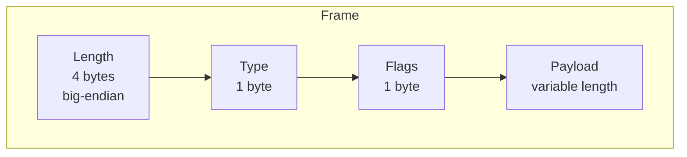
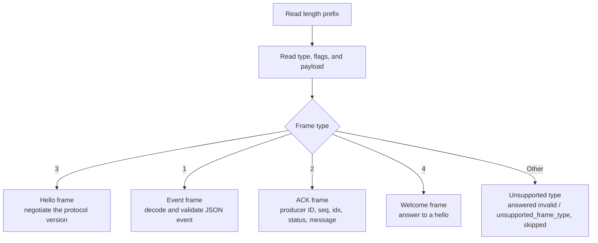
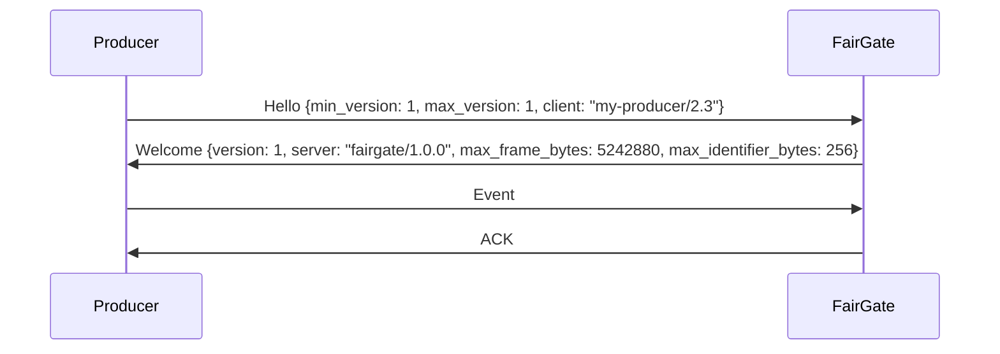

[FairGate](../README.md) › [Docs](README.md) › Wire protocol

# Wire protocol

FairGate uses a length-prefixed frame format. Fields are transmitted in the order shown. The frame header (length, type, flags) is the same in every protocol version; everything else is negotiated when a connection opens (see [Handshake and versioning](#handshake-and-versioning)).

| Field | Size | Description |
|---|---|---|
| Length | 4 bytes, big-endian | Number of bytes that follow: type, flags, and payload. At least 2, and at most `server.max_frame_bytes` (5 MiB by default). |
| Type | 1 byte | Identifies the frame kind (see below). |
| Flags | 1 byte | Reserved. Send `0`; the gateway ignores it. A later protocol version may define flags, only for connections that negotiate it. |
| Payload | Variable | Frame body, interpreted according to the type. |

How frames are demultiplexed on a connection:

Hello and event frames flow from producer to server; welcome and ACK frames flow from server to producer.

The current frame types are:

| Type | Direction | Purpose |
|---|---|---|
| `1` | Producer to server | Event |
| `2` | Server to producer | Acknowledgment (ACK) of one event frame |
| `3` | Producer to server | Hello: the first frame of a connection, offering protocol versions |
| `4` | Server to producer | Welcome: the answer to a hello |

## Handshake and versioning

A client opens each connection with a hello listing the protocol versions it speaks. The server picks the highest version both speak and answers with a welcome. Only then does the client send events.

Hello (type `3`):

| Field | Type | Description |
|---|---|---|
| `min_version` | integer | Oldest protocol version the client speaks. At least 1. |
| `max_version` | integer | Newest protocol version the client speaks. At least `min_version`. |
| `client` | string, optional | Client name and version, for logs. At most 256 bytes. |

Welcome (type `4`):

| Field | Type | Description |
|---|---|---|
| `version` | integer | The negotiated version. Set unless `error` is. |
| `server` | string | Server name and version, for logs. |
| `max_frame_bytes` | integer | Largest frame the server accepts (`server.max_frame_bytes`). |
| `max_identifier_bytes` | integer | Largest `producer_id`, `producer_epoch`, and `event_type` the server accepts. |
| `error` | string | Set when the hello is refused: `unsupported_version`, `invalid_hello`, or `unexpected_hello`. The server closes the connection after sending it. |
| `supported_min_version`, `supported_max_version` | integer | With `unsupported_version`: the range the server speaks. |

The Go helper `wire.Handshake` sends a hello for every version the `wire` package speaks and checks the welcome. The load generator uses it for every connection.

### Versions

| Version | Status | Differences |
|---|---|---|
| `0` (legacy) | Accepted while `server.allow_legacy_clients` is `true` (the default) | No handshake: the first frame is an event. |
| `1` | Current | Negotiated with a hello. Events and ACKs are the same as in version 0. |

A connection whose first frame is an event speaks version 0. When `server.allow_legacy_clients` is `false`, that event is answered `invalid` / `hello_required` and the connection is closed. `fairgate_protocol_connections_total{version}` counts connections by version, with `legacy` for version 0, so you can see when every producer negotiates a version before turning legacy clients off.

### Compatibility rules

- The frame header never changes.
- Both sides ignore unknown JSON fields in hellos, welcomes, events, and ACKs, so a version can add optional fields without breaking older peers.
- Anything older peers cannot ignore needs a new version: a new required field, a changed meaning, or a new frame type in the event stream. A newer client keeps working with an older server by offering a range that includes the server's newest version.
- Each server release speaks the current version and the previous one.
- A hello is accepted only as the first frame. A second one, or a hello after legacy events, is answered with `unexpected_hello` and closes the connection.

An ACK contains the producer ID, sequence number, event index, status, and an optional message. An `accepted` ACK indicates that the event was written to the WAL and enqueued, or that it is an identical retry of an event that was already accepted. It does **not** indicate that a downstream database has stored or queried the event.

A `rejected` ACK means the gateway refused the event and did not persist it, and the producer should retry it after backing off. Its message says why: `rate_limited` for admission control, `queue_backlogged`, `gateway_backlogged`, or `storage_backlogged` when a backlog is over its limit (see [Overload handling](scheduling.md#overload-handling)), or `storage_unavailable` when the WAL cannot make events durable (see [Write and sync failures](wal.md#write-and-sync-failures)).

An event whose JSON encoding exceeds the WAL record limit of 1 MiB is rejected with status `invalid` and message `payload_too_large`, even though its frame is within the frame limit. The connection stays open.

## Error handling

The gateway answers every frame it reads with exactly one reply, including frames it cannot handle: a welcome for a hello, and an ACK for every other frame. Those ACKs have status `invalid` and no producer ID, sequence, or index, because the frame was never decoded. A client that pipelines frames can therefore match ACKs to frames in order. Do not retry a frame that was answered `invalid` without changing it.

| Problem | ACK message | Connection |
|---|---|---|
| Length prefix of 0 or 1 | `malformed_frame` | Closed: the next frame boundary is unknown. |
| Length over `server.max_frame_bytes`, up to 4 times it | `frame_too_large` | Kept. The body is read and discarded without being buffered, then the ACK is sent. |
| Length more than 4 times `server.max_frame_bytes` | `frame_too_large` | Closed without reading the body. If the client is still writing, the close may reset the connection before it reads the ACK. |
| Frame type other than `1` or `3` | `unsupported_frame_type` | Kept. |
| Event as the first frame while `server.allow_legacy_clients` is `false` | `hello_required` | Closed. |
| Payload that is not valid JSON, misses a required field, or has an identifier over 256 bytes (see [Event model](event-model.md#event-model)) | `invalid_payload` | Kept. |
| Event over the WAL's 1 MiB record limit | `payload_too_large` | Kept. |

The gateway also bounds how long a client can hold a connection without making progress:

| Situation | Limit | Result |
|---|---|---|
| A frame has started arriving but is not complete | `server.frame_timeout` (30 s) | Connection closed. This also covers a partial length prefix. |
| No new frame starts | `server.idle_timeout` (off by default) | Connection closed. |
| The client does not read an ACK | `server.write_timeout` (10 s) | Connection closed. |
| The connection ends inside a frame | | The partial frame is dropped. |

Memory for a frame body grows as its bytes arrive, starting at 64 KiB, so a client that announces a large frame and sends little of it costs little memory. Each case is counted in `fairgate_protocol_errors_total{reason}`; see [Observability](observability.md#metrics).

Refer to the `wire` package for the current protocol implementation and exact encoding behavior.
