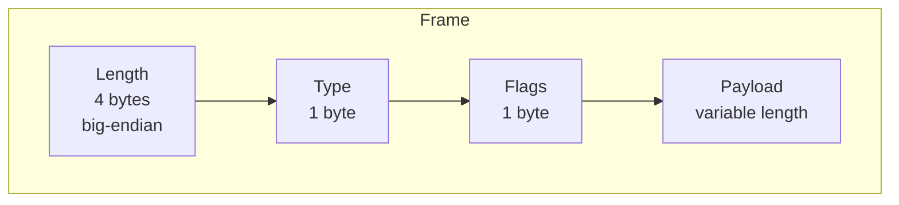
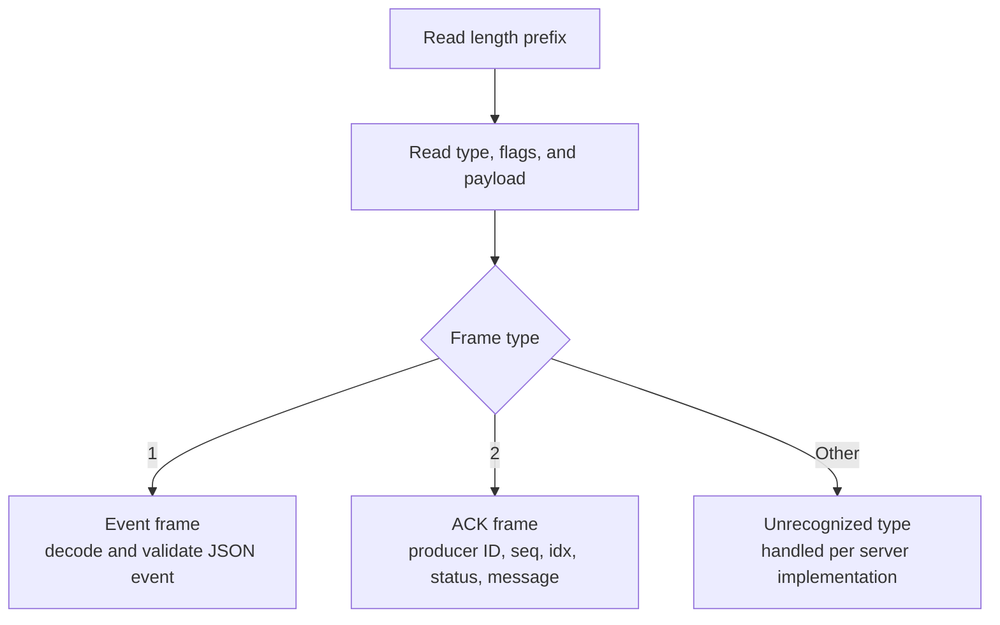

[FairGate](../README.md) › [Docs](README.md) › Wire protocol

# Wire protocol

FairGate uses a length-prefixed frame format. Fields are transmitted in the order shown.

| Field | Size | Description |
|---|---|---|
| Length | 4 bytes, big-endian | Frame length prefix used to delimit frames on the TCP stream. The maximum frame size is 5 MiB. |
| Type | 1 byte | Identifies the frame kind (see below). |
| Flags | 1 byte | Per-frame flags. |
| Payload | Variable | Frame body, interpreted according to the type. |

How frames are demultiplexed on a connection:

Event frames flow from producer to server and ACK frames flow from server to producer.

The current frame types are:

| Type | Purpose |
|---|---|
| `1` | Event |
| `2` | Acknowledgment (ACK) |

An ACK contains the producer ID, sequence number, event index, status, and an optional message. An `accepted` ACK indicates that the event was written to the WAL and enqueued, or that it is an identical retry of an event that was already accepted. It does **not** indicate that a downstream database has stored or queried the event.

Refer to the `wire` package for the current protocol implementation and exact encoding behavior.
