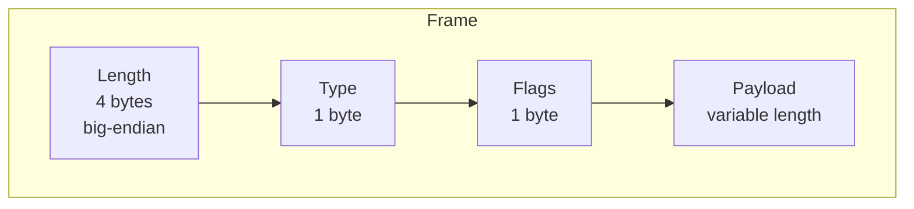
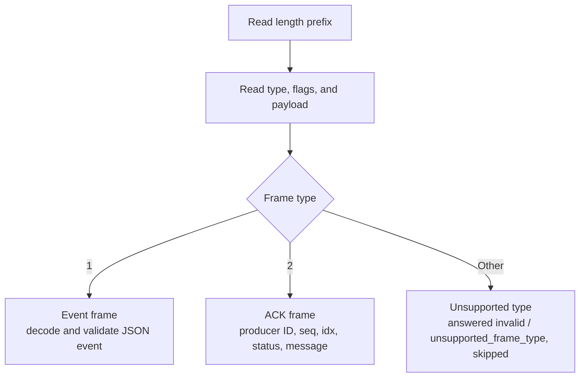

[FairGate](../README.md) › [Docs](README.md) › Wire protocol

# Wire protocol

FairGate uses a length-prefixed frame format. Fields are transmitted in the order shown.

| Field | Size | Description |
|---|---|---|
| Length | 4 bytes, big-endian | Number of bytes that follow: type, flags, and payload. At least 2, and at most `server.max_frame_bytes` (5 MiB by default). |
| Type | 1 byte | Identifies the frame kind (see below). |
| Flags | 1 byte | Reserved. Send `0`; the gateway ignores it. |
| Payload | Variable | Frame body, interpreted according to the type. |

How frames are demultiplexed on a connection:

Event frames flow from producer to server and ACK frames flow from server to producer.

The current frame types are:

| Type | Purpose |
|---|---|
| `1` | Event |
| `2` | Acknowledgment (ACK) |

An ACK contains the producer ID, sequence number, event index, status, and an optional message. An `accepted` ACK indicates that the event was written to the WAL and enqueued, or that it is an identical retry of an event that was already accepted. It does **not** indicate that a downstream database has stored or queried the event.

A `rejected` ACK means the gateway refused the event and did not persist it, and the producer should retry it after backing off. Its message says why: `rate_limited` for admission control, or `queue_backlogged`, `gateway_backlogged`, or `storage_backlogged` when a backlog is over its limit (see [Overload handling](scheduling.md#overload-handling)).

An event whose JSON encoding exceeds the WAL record limit of 1 MiB is rejected with status `invalid` and message `payload_too_large`, even though its frame is within the frame limit. The connection stays open.

## Error handling

The gateway answers every frame it reads with exactly one ACK, including frames it cannot handle. Those ACKs have status `invalid` and no producer ID, sequence, or index, because the frame was never decoded. A client that pipelines frames can therefore match ACKs to frames in order. Do not retry a frame that was answered `invalid` without changing it.

| Problem | ACK message | Connection |
|---|---|---|
| Length prefix of 0 or 1 | `malformed_frame` | Closed: the next frame boundary is unknown. |
| Length over `server.max_frame_bytes`, up to 4 times it | `frame_too_large` | Kept. The body is read and discarded without being buffered, then the ACK is sent. |
| Length more than 4 times `server.max_frame_bytes` | `frame_too_large` | Closed without reading the body. If the client is still writing, the close may reset the connection before it reads the ACK. |
| Frame type other than `1` | `unsupported_frame_type` | Kept. |
| Payload that is not valid JSON, misses a required field, or has an identifier over 256 bytes (see [Event model](event-model.md#event-model)) | `invalid_payload` | Kept. |
| Event over the WAL's 1 MiB record limit | `payload_too_large` | Kept. |

The gateway also bounds how long a client can hold a connection without making progress:

| Situation | Limit | Result |
|---|---|---|
| A frame has started arriving but is not complete | `server.frame_timeout` (30 s) | Connection closed. This also covers a partial length prefix. |
| No new frame starts | `server.idle_timeout` (off by default) | Connection closed. |
| The client does not read an ACK | `server.write_timeout` (10 s) | Connection closed. |
| The connection ends inside a frame | | The partial frame is dropped. |

Memory for a frame body grows as its bytes arrive, starting at 64 KiB, so a client that announces a large frame and sends little of it costs little memory. Each case is counted in `fairgate_protocol_errors_total{reason}`; see [Observability](observability.md#metrics).

Refer to the `wire` package for the current protocol implementation and exact encoding behavior.
